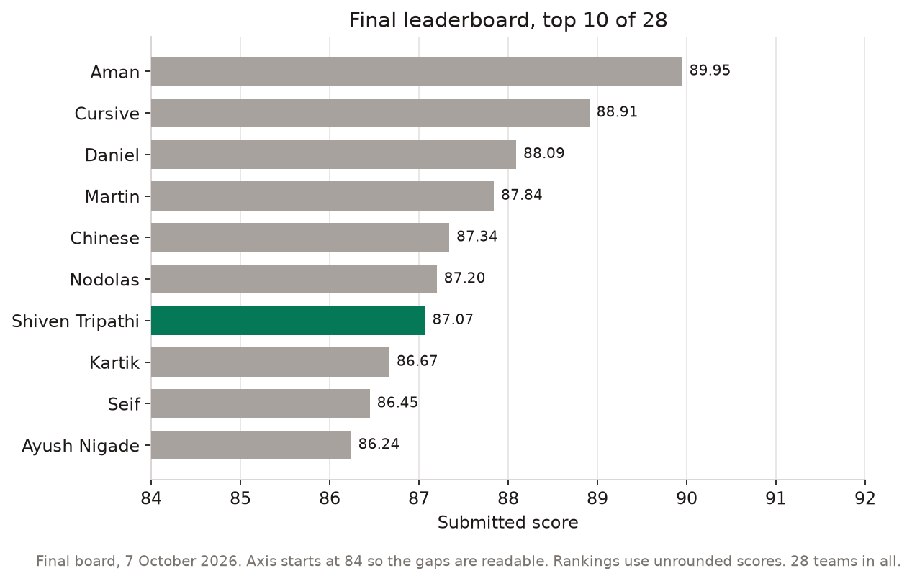
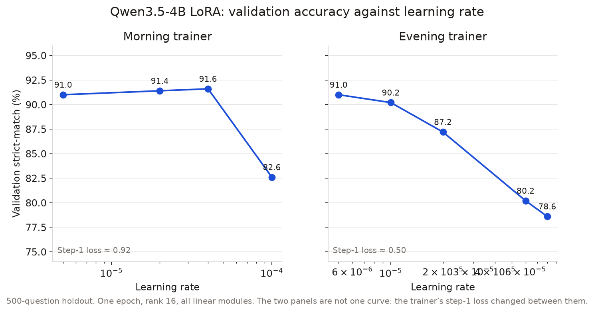
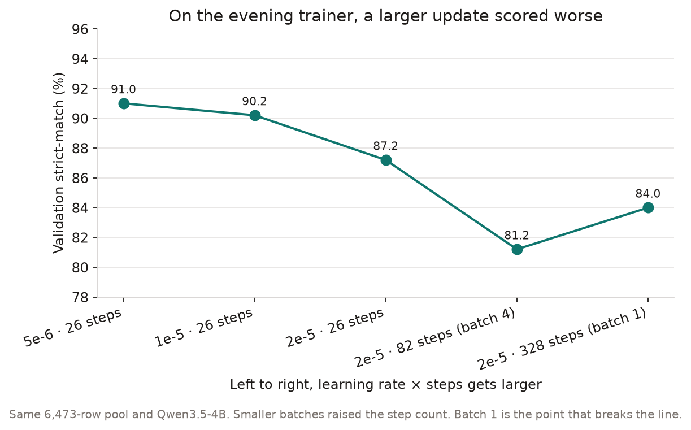
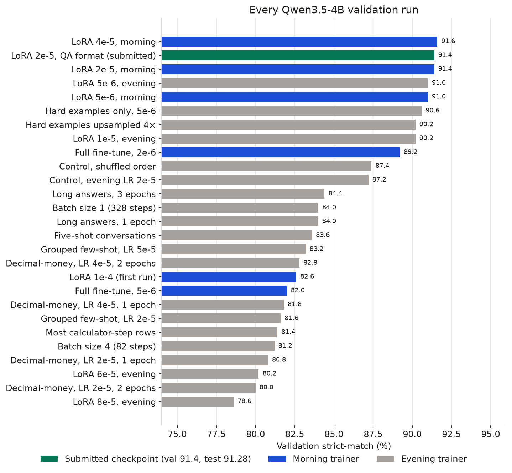
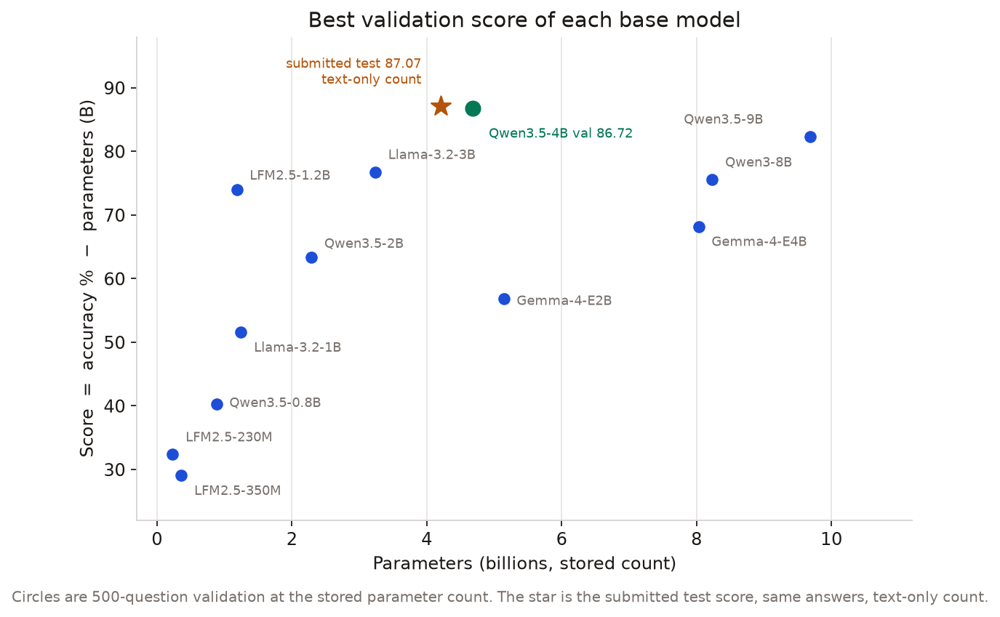
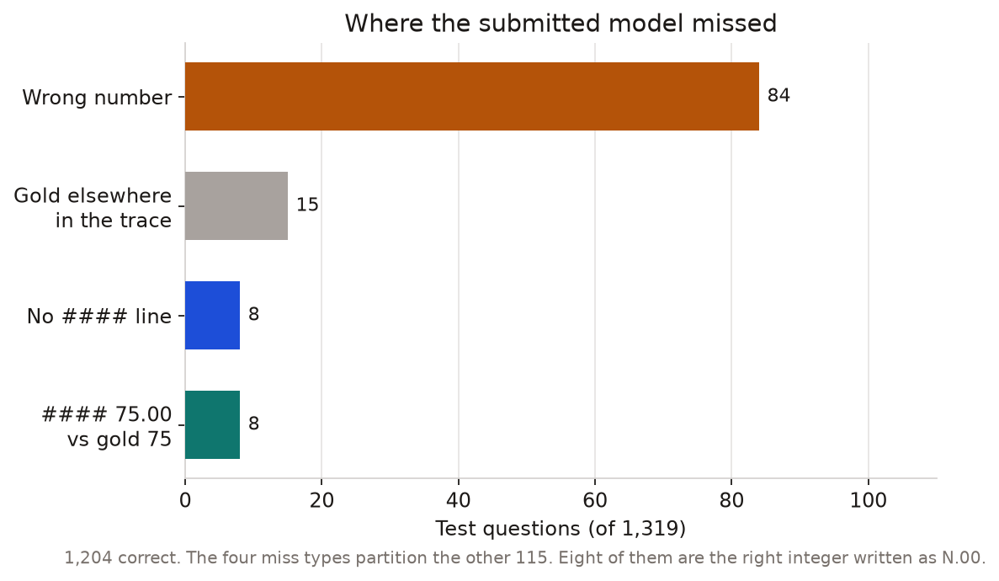

# Fine-tuning a 4B model to 91.3% on GSM8K

I trained small language models for [Overmind’s Small Model, Big Maths challenge](https://www.overmindlab.ai/hack) in October 2026. The score is strict-match accuracy on GSM8K minus the model’s size in billions of parameters. I finished **7th of 28**, with a submitted score of **87.07**.

The checkpoint behind that score gets **1,204 of 1,319** test questions right (**91.28%**). The protocol is EleutherAI `lm-eval`, task `gsm8k`, 5-shot, greedy decoding, one answer per question, at most 1,024 generated tokens, with the answer written as `#### N`. I chose the checkpoint on a 500-question validation holdout before that test. The test set was scored twice in the whole project, on two different checkpoints, and never used to pick a winner.



Two ways to count the same 1,204 answers:

| What is counted | Parameters | Score |
| --- | ---: | ---: |
| Full checkpoint: Qwen3.5-4B plus the LoRA adapter | 4,681,098,752 | **86.60** |
| Text-only language model, LoRA merged, vision tower and multi-token prediction head removed | 4,205,751,296 | **87.07** |

The leaderboard entry is the second number. The first is the score if every stored tensor counts. Both counts come from safetensors headers, not from the model card’s “4B”. The winner, Aman, scored 89.95. I did not catch that.

The useful part of the project is the sweep around this result: which updates help, which ones overwrite a model that was already good, and how to tell a broken training load from a bad hyperparameter.

## The setup

GSM8K train has 7,473 worked grade-school word problems. I held out 500 of them, seed 1234, and trained only on the rest. The input is the question. The target is the official worked answer, copied verbatim, including the `<<48/2=24>>` annotations and the final `#### 72`.

Training was supervised fine-tuning with LoRA on Overmind: rank 16, alpha 32, dropout 0, every linear module the trainer would attach, one epoch, warmup 0.05, context length 4,096. Loss is on the assistant tokens only. Qwen’s non-thinking chat template puts an empty `<think></think>` in front of the answer, so evaluation uses that same template with thinking off.

Strict-match is a regex, `####` followed by a number. Flexible-extract, which takes the last number in the reply, is recorded and is not the contest metric. A model can do the arithmetic and still score zero by writing “the answer is 72.”

## What a gentle LoRA does

On a strong instruct model, this kind of fine-tune mostly teaches the answer format. The base model already solves a lot of GSM8K. A small update pulls it onto the `#### N` convention without replacing its own reasoning. A large update copies the short style of the gold solutions and drops questions it used to get right.



On the morning trainer, Qwen3.5-4B LoRA sat at 91.0–91.6% validation for learning rates 5e-6, 2e-5, and 4e-5. At 1e-4 it fell to 82.6%. That 1e-4 run is the first test score, 81.65% (1,077/1,319), official score 76.97. I kept it as a result and did not use it to choose the next checkpoint.

Later the same day the trainer changed underneath the recipe. Step-1 loss on Qwen3.5-4B moved from about 0.92 to about 0.50, so the same nominal learning rate took a bigger step. The morning control, retrained in the evening at 2e-5, scored 87.2 instead of 91.4. I stopped comparing losses across that shift. Lowering the evening learning rate to 5e-6 brought validation back to 91.0. That is the best evening run, and it still does not beat the morning checkpoint, so it never got a test evaluation.



Batch size is part of the dose. On this trainer, a smaller batch means more optimizer steps per epoch. The full pool at the default batch is 26 steps. Batch 4 is 82 steps and scored 81.2. Batch 1 is 328 steps and scored 84.0. Both are the same learning rate, 2e-5, that scored 87.2 in 26 steps. Full fine-tuning showed the same shape: learning rate 2e-6 scored 89.2 validation, and 5e-6 scored 82.0.

## The runs that did not beat it



I tried to aim the small update at the questions the submitted model missed, without leaving the official training data.

- Training only on the 526 train questions it got wrong scored 90.6. It forgot some questions it used to get right.
- Keeping the full pool and adding four extra copies of those 526 scored 90.2. Paired against the 91.0 run, that is 3 new correct answers and 7 new misses.
- Long answers, calculator-heavy answers, decimal-money answers, and few-shot conversations packed into the target all landed between 80 and 84.
- A shuffled copy of the control scored 87.4 against 87.2. That gap is noise (paired z = 0.33). Comparisons after that used the same questions, not two independent accuracy numbers.

The full table, with job ids, step counts, and flexible-extract, is in [docs/experiments.md](docs/experiments.md).

## Smaller models do not win on the discount

One billion parameters costs one accuracy point. A smaller model only wins if it gives up fewer points of accuracy than it gets back from the penalty.



Qwen3.5-9B reached 92.0% validation and scored 82.3, because 9.7B costs more than the extra correct answers return. Llama-3.2-3B reached 80.0% and scored 76.8. Qwen3.5-2B topped out at 65.6% even at its best learning rate, and flexible-extract was 68.6%, so the missing points were not hiding in the answer format. LFM2.5-1.2B was the best small model I measured, 75.2% and a score of 74.0, still well behind the 4B.

## Where the submitted model is wrong



Of the 115 test misses, 84 are a wrong number on the `####` line. Fifteen have the gold integer somewhere else in the trace. Eight have no `####` line. Eight are the right integer written as `75.00` instead of `75`. Strict-match strips a trailing period, not a trailing `.00`, and every gold answer in the training split is an integer. Those eight are 0.6 accuracy points. Training on the decimal-money subset, which is the legal way to emphasize that pattern, made validation worse, not better.

## A broken load looks like a bad learning rate, until you read step 1

Qwen3-4B, Qwen3-1.7B, and Qwen3-0.6B share tied embeddings. On the first trainer their step-1 loss was 6 to 10 and token accuracy was about 0.14. A real forward pass of the base model on this data is a loss near 1. Qwen3-8B, which stores an untied output head, trained normally (2.31 → 0.24) and then scored 83.8% validation, which is a poor score at 8.2B. The tied models were not learning. They were starting from a bad load. I reported that, and a later job confirmed the fix: Qwen3-1.7B step-1 loss went from 10.34 to 1.56.

The fixed run was still a bad fine-tune. Batch size 16 became 405 steps, the loss fell from 1.56 to 0.45, and validation was 34.4% strict / 62.4% flexible. Most misses had no `####` line, and the flexible score was below the untuned model. I did not open the test set for it. A healthy step-1 loss means the loader works. It does not mean the learning rate is right.

Thinking is the same kind of measurement. With thinking on and a 1,024-token cap, two 20-question probes of checkpoints that score about 91% with thinking off scored 55% and 35%. The generation ran out of tokens inside the thought. Thinking stayed off.

## What I would repeat

1. Count parameters from the checkpoint, including the adapter, and write down any tensor you propose to exclude.
2. Hold out validation from the training split before the first run. Score the test set once, on a checkpoint you have already chosen.
3. Compare models on the same questions. A one-point gap on 500 items is often noise.
4. Start from the base model’s step-1 loss. If that number is nonsense, stop tuning the learning rate.
5. On a strong instruct model, treat the learning rate times the number of steps as the thing you are choosing. A format-teaching update is small. A larger one can lower the score.
6. Read strict-match and flexible-extract together. A wide gap is a format problem. A low flexible score is the model not knowing the answer.

## Reproduce the figures

```bash
uv run --with matplotlib python scripts/plot_results.py
```

The script contains the measured numbers and writes `figures/`. Weights, the GSM8K files, and the raw sample logs are not in this repository. The contest forbids training on anything but the official GSM8K train split, and it forbids starting from a checkpoint that was already fine-tuned on GSM8K.

GSM8K is [Cobbe et al., 2021](https://arxiv.org/abs/2110.14168). Evaluation is [lm-eval](https://github.com/EleutherAI/lm-evaluation-harness) 0.4.13. The base model is [Qwen3.5-4B](https://huggingface.co/Qwen/Qwen3.5-4B). LoRA is [Hu et al., 2021](https://arxiv.org/abs/2106.09685).
